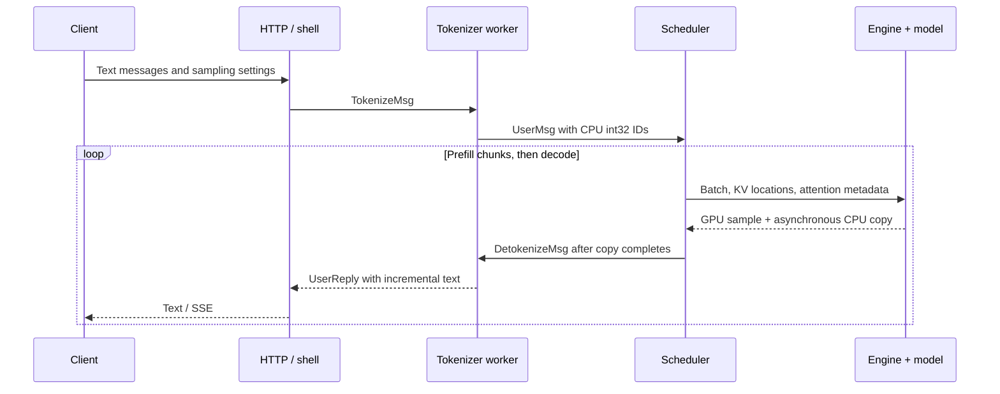

# Walk through an inference engine

Begin with a single greedy request, then add batching, caching, and asynchronous
execution. This guide describes this checkout; original commits use older names.
The [README](../README.md) contains installation and runnable examples.

## Reading order

The package is flat: all 20 Python files live in `python/minisgl/`. There are no
model registries, custom module frameworks, global batch contexts, or scheduler
manager hierarchies. Each file owns one mechanism or a small group used together.

| Read | File | What it owns |
|---|---|---|
| 1 | [models.py](../python/minisgl/models.py) | Decoder forward, architecture differences, checkpoint packing |
| 2 | [layers.py](../python/minisgl/layers.py) | RoPE, fused norms, TP projections/embedding, expert weights |
| 3 | [core.py](../python/minisgl/core.py) | Request state, batches, sampling settings |
| 4 | [llm.py](../python/minisgl/llm.py) | Offline tokenization, scheduler loop, output collection |
| 5 | [scheduler.py](../python/minisgl/scheduler.py) | Admission, prefill/decode selection, overlap, completion |
| 6 | [engine.py](../python/minisgl/engine.py) | GPU setup, weights, model execution, sampling, D2H copy |
| 7 | [kvcache.py](../python/minisgl/kvcache.py) | KV tensors, physical pages, radix prefixes, locks, eviction |
| 8 | [attention.py](../python/minisgl/attention.py) | Kernel calls and phase-specific attention metadata |
| 9 | [graph.py](../python/minisgl/graph.py) | Decode capture/replay, persistent buffers, padding |
| 10 | [distributed.py](../python/minisgl/distributed.py) | Rank information, GPU collectives, pipeline stages |
| 11 | [server.py](../python/minisgl/server.py) | HTTP/shell, worker lifecycle, TP request broadcast |
| 12 | [tokenizer.py](../python/minisgl/tokenizer.py) | Chat templates, encoding, incremental text decoding |
| 13 | [message.py](../python/minisgl/message.py) | CPU messages, MessagePack, ZeroMQ sockets |
| 14 | [config.py](../python/minisgl/config.py) | One runtime Config, normalized ModelConfig, CLI |
| 15 | [kernel.py](../python/minisgl/kernel.py) | Lazy C++/CUDA bindings for gather/store/radix/NCCL |
| 16 | [moe.py](../python/minisgl/moe.py) | Routing and grouped expert matmul launches |
| 17 | [moe_kernel.py](../python/minisgl/moe_kernel.py) | Triton expert matmul and reduction |
| 18 | [utils.py](../python/minisgl/utils.py) | Shape arithmetic, Hub loading, logging, memory helpers |
| 19 | [__main__.py](../python/minisgl/__main__.py) | CLI entry point |
| Optional | [benchmark.py](../python/minisgl/benchmark.py) | HTTP timings and CUDA kernel measurements |

The native sources are in `python/minisgl/csrc/`. They implement embedding
lookup, KV writes, CPU prefix comparison, and the small PyNCCL binding. The
vendored NCCL header is API declaration material, not another serving framework.

## Start with the transformer

`DecoderForCausalLM` is a normal `torch.nn.Module`: an embedding, a `ModuleList`
of pre-norm decoder blocks, a final RMSNorm, and an LM head. `create_model` selects
architecture options, sets eval mode, and disables gradients. Weights are built
on `meta`, then assigned from the checkpoint; initialization never allocates
random GPU parameters. One FP32 RoPE table is shared by all layers.

For T newly processed tokens and H hidden features:

```
input_ids [T] -> embedding [T,H]
  -> residual RMSNorm -> QKV projection -> optional Q/K norm -> RoPE
  -> write K/V -> causal attention -> output projection
  -> residual RMSNorm -> gate/up -> activation(gate) * up -> down
  -> repeat layers -> residual RMSNorm -> selected states -> vocabulary logits
```

For prefill, T is the sum of uncached prompt/chunk lengths. Only the final state
of each request needs the LM head. Decode consumes one token per request, so
T is the batch size, including padding when a graph is used.

`ResidualRMSNorm` carries two tensors: the new branch and the accumulated
residual. The fused kernel updates both in place. Read that contract before
rewriting the block as separate additions and normalizations.

| Architecture entry | Difference from the shared dense decoder |
|---|---|
| `LlamaForCausalLM` | Baseline: bias-free QKV, gated feed-forward |
| `Qwen2ForCausalLM` | QKV biases |
| `Qwen3ForCausalLM` | Per-head Q/K RMSNorm before RoPE |
| `Qwen3MoeForCausalLM` | Q/K norm plus routed experts |
| `MistralForCausalLM` | Dense text decoder |
| `Mistral3ForConditionalGeneration` | Text decoder under a multimodal checkpoint wrapper |

This table describes implemented paths, not blanket support for every model
using those family names. Sliding windows, alternative norms/activations, vision,
and new recurrent blocks need explicit implementation and validation.

Checkpoint keys follow ordinary module attribute names. Renaming `qkv_proj`,
`model`, or `layers` changes loading; renaming a local variable does not. The
loader shards individual Q/K/V and gate/up weights **before** concatenating them.
Splitting an already packed QKV tensor into equal pieces gives ranks the wrong
heads. Expert tensors are stacked in expert-index order. For tied vocabulary
weights, `load_state_dict(assign=True)` lets embedding and head share storage.

## Trace one message to a response



Offline inference skips the sockets and subprocesses. `LLM` owns a `Scheduler`,
encodes prompts, calls `step(messages)`, and collects token replies. Online
inference uses one text worker for tokenization **and** detokenization, plus one
scheduler process per GPU. The frontend only routes replies to request queues.

For a live walkthrough, stop in these functions in order:

1. `tokenizer.tokenize`: apply the chat template directly to IDs. Rendering to a
   string and encoding with special tokens again can duplicate BOS.
2. `Scheduler._handle_message`: check the context limit and queue the request.
3. `_prefill_batch`: match a prefix, lock it, reserve capacity, stage a prompt chunk.
4. `_prepare_batch`: allocate pages, gather token positions, prepare kernel metadata.
5. `Engine.forward_batch`: run the model or graph, sample, enqueue the CPU copy.
6. `_process_completed_batch`: wait for that copy, append the ID, finish or continue.
7. `DetokenizeManager.detokenize`: turn overlapping token context into new text.

The terminal reply distinguishes `stop` (any EOS token from `config.json` or
`generation_config.json`) from `length` (output budget).
An ignored EOS remains an output token. Cancellation releases rows/pages once;
the tokenizer drops decoder state after the scheduler acknowledges it. Invalid
prompt lengths return an error instead of leaving a waiting client without a reply.

Worker failure is a persistent frontend state. The monitor sets it before failing
existing queues; a later request is rejected before it can enqueue. Submissions
also wait on that state while a socket send is pending. Requests reaching the
frontend before response headers get HTTP 503; an open chat stream gets a
`server_error` event. Shutdown allows five seconds to drain HTTP tasks, then
cancels them, joins workers, and exits nonzero. This also bounds requests that
never finish sending their HTTP body, which cannot yet receive the frontend's
503. Background abort sends are cancelled before their sockets close.

## Separate scheduled work from delivered tokens

| Request field | Meaning |
|---|---|
| `prompt_len` | Full prompt length for the final prefill request |
| `cached_len` | Logical prefix whose KV writes have been submitted |
| `scheduled_len` | Logical input length at the next forward |
| `num_new_tokens` | `scheduled_len - cached_len` |
| `num_output_tokens` | Output IDs already appended to CPU history |
| `max_seq_len` | Prompt length plus admitted output budget |

For a four-token prompt, prefill processes positions `[0,1,2,3]`, writes their
KV, and samples y0. Now `cached_len=4`, `scheduled_len=5`. Decode consumes y0 at
position 4, writes its KV, and samples y1. The final sampled token needs no KV
because no later forward consumes it.

Advancing those lengths submits work; it does not imply GPU completion or CPU
visibility. With overlap, the following forward may already be queued when the
previous ID arrives on CPU. Only **delivered** tokens exhaust the output budget.

Chunked prefill uses a fixed token budget per batch. A seven-token prompt with
budget three runs chunks of 3, 3, and 1. Each chunk has a separate `Request`
record, but reuses the row, prefix lock, and KV. The immutable `is_prefill_chunk`
flag ensures a delayed result from an intermediate chunk never emits a token.
The sampled ID from such a chunk is discarded; the next input is prompt text.
Prefill has priority over decode in this scheduler; it does not implement a more
elaborate fairness policy or mixed prefill/decode batches.

## Keep logical positions, token slots, and pages separate

| Structure | Index | Stored value |
|---|---|---|
| `token_pool` | Request row, logical position | GPU token ID |
| `page_table` | Request row, logical position | Physical KV token slot |
| KV pool | K/V, layer, page, token, local KV head, feature | K or V vector |
| `free_pages` | Free-page entry | Page-aligned physical token offset |
| Radix tree | CPU token prefix | Reusable physical KV token slots |

For page size four, free entries `[0,4,8]` describe three pages. The middle page
contains slots `[4,5,6,7]`. Admission reserves **whole pages** through the future
KV length, not just the count of requested tokens. Otherwise many one-token
requests can appear to fit while exhausting the actual page pool.

KV bytes per token on one rank are:

```
2 * num_layers * local_kv_heads * head_dim * dtype.itemsize
```

The factor two is K plus V. KV-head replication means increasing TP eventually
stops reducing this term. Allocator pages and attention-library pages need not
match: FlashInfer sees this same storage as one-token pages. FA/TRTLLM adapters
convert token slots to page numbers at page boundaries.

`KVCacheManager` coordinates two owners: active requests and the prefix tree.
A prefix in the tree can be resident **and evictable**; that memory is capacity
admission can reclaim. Locks protect every node from the match to the root.
Only a 0↔1 lock-count transition changes the protected/evictable token totals.

Read `_split_edge`, `cache_req`, and `evict` together. Splitting preserves old
handles and their path locks. Insertion clones KV locations so later reuse of a
request's page-table row cannot overwrite the cache. Concurrent requests may
compute duplicate prefixes; insertion retains one copy and frees the duplicate.
Only complete pages enter the tree; an unshared partial tail is freed on finish.
Matching excludes the prompt's final token because the cache stores KV, not its
logits: one prompt token must still run to produce the next-token distribution.

## Add overlap, CUDA graphs, and backend choices

With `overlap=False`, one `Scheduler.step` submits a forward and consumes its
CPU result. With overlap, it submits the current forward before consuming the
previous result. GPU token IDs feed the next step directly from `token_pool`,
without waiting for CPU detokenization.

```
CPU:   prepare batch N -> submit N -> retire CPU result N-1 -> prepare N+1
GPU:         forward N-1 -> sample/copy -> forward N -> sample/copy
```

The metadata and engine CUDA streams have explicit dependencies before consuming
new indices or reusing rows. `ScheduledBatch` retains index/sampling tensors
until the corresponding work finishes. FlashInfer also reuses pinned host
planning buffers: its event guard prevents a new plan from overwriting memory
still being copied asynchronously. Removing that wait can corrupt metadata
without a Python exception.

Graphs reduce decode launch overhead. Capture uses fixed input, position, KV
location, and logit addresses. Replay copies new values into those addresses.
A batch of three can run a graph captured for four; a dummy row/page absorbs the
extra work. Prefill and sampling remain outside the captured model forward.

| `--attn` | Implementation in this checkout |
|---|---|
| `fi` | FlashInfer wrappers, explicit `fa2` kernel backend, both phases |
| `trtllm` | FlashInfer TRTLLM context and decode entry points |
| `fi,trtllm` | FlashInfer prefill, TRTLLM decode |

An API name is not a hardware-support guarantee. Auto selection uses `trtllm` on
SM10x and `fi` everywhere else. RTX PRO 6000 Blackwell is SM120; the SM10x TRTLLM
prefill path does not work there, but `fi,trtllm` does. TRTLLM requires allocator
page sizes 16/32/64; other values are resolved to 64. Backend speed depends on
model, batch, context, and phase; no speed ranking is assumed here.

FlashAttention is disabled for the tested dependency set: importing SGL-Kernel
0.3.21's FA entry point fails with CUTLASS DSL 4.8.1, while FlashInfer
0.7.2.post1 requires DSL >=4.6.2. This is a version compatibility limit, not a
claim about every future release. Restoring FA needs a compatible set and GPU validation.

Splitting fused QKV produces strided views. The TRTLLM adapter makes Q contiguous
because its kernels read packed batch rows. Testing one request can hide this bug:
later rows in a batch expose it. Preserve varied batched prompts when validating
kernel changes.

## Add tensor parallelism, pipeline parallelism, and experts

Column-parallel QKV and gate/up projections shard output features. Row-parallel
output/down projections compute partial hidden states and sum them. A bias on a
row-parallel projection must be added **after** the sum. When TP exceeds KV heads,
adjacent ranks replicate a head. Vocabulary projection all-gather returns
`[rank,token,local_vocab]`; permute to `[token,rank,local_vocab]` before flattening
and trimming padded vocabulary rows.

`server._receive_requests` uses Gloo to distribute the same ordered request
packets to all ranks. Decode requests are sorted by UID, since Python set order
can differ between processes. GPU all-reduce/all-gather use the small PyNCCL
binding by default, or PyTorch NCCL with `--disable-pynccl`. A single GPU needs
neither a process group nor a distributed TCP port.

An idle primary wakes once a second to broadcast an empty packet. Without that
tick, other ranks wait in a Gloo receive that fails after its 60-second timeout.

Pipeline parallelism cuts by depth instead of width. Each stage owns a contiguous
range of layers and only their KV, so the gain is memory, not latency: one forward
still passes through every stage. This engine runs stages in lockstep, with no
micro-batching to keep several stages busy at once.

```
stage 0: embed -> layers 0..13  -- send x, residual [T,H] -->
stage 1:          layers 14..27 -> norm -> lm_head -> sample
every rank <-- broadcast next tokens [batch] -- stage 1
```

The design leans on one fact: every rank runs an identical scheduler on identical
messages, so all ranks already agree on batches, page tables, and T. Stages need no
shape exchange, and no rank coordinates another. Only sampled tokens have to travel
back, because each scheduler must retire the same work. Unlike TP, PP changes no
arithmetic, so its logits should match a single rank bit for bit.

`distributed.send/recv/broadcast` use PyNCCL because it enqueues on the current CUDA
stream, which lets graphs capture them. TP and PP are alternatives here; combining
them needs two communicators and a rank grid.

To try either on one GPU, pass `--tp 2` or `--pp 2`. NCCL normally rejects two ranks
on one device ("Duplicate GPU detected"), so `Engine` gives each rank its own
`NCCL_HOSTID`. NCCL then treats them as separate hosts and talks over loopback.

For MoE, begin at `MoEFeedForward`: router logits select top-k experts, optional
renormalization sets route weights, and expert projections shard the intermediate
features across TP ranks. `moe.py` sorts/blocks token-expert assignments and
launches two grouped matmuls. Read its tensor shapes before `moe_kernel.py`.

## Bugs worth reproducing

Each of these was silent or delayed, and each has a regression test. Revert the fix
and watch it fail.

| Symptom | Cause | Test |
|---|---|---|
| Two identical prompts; one turns to garbage once a later request arrives | The loser of a prefix insert freed its pages but kept decoding from them | `test_duplicate_prefix_repoints_the_live_row_before_freeing_its_pages` |
| An idle TP server dies after one minute | Ranks waited in a Gloo receive with a 60-second timeout | `test_idle_tp_primary_wakes_so_other_ranks_never_hit_the_gloo_timeout` |
| A request arriving during worker-failure shutdown hangs | The monitor only failed the current UID snapshot | `test_worker_failure_rejects_a_request_registered_after_the_monitor_ran` |
| A send waits forever on a dead tokenizer | Worker failure did not interrupt submission | `test_worker_failure_interrupts_a_submission_waiting_on_a_dead_tokenizer` |
| Ctrl-C with an open stream reports a crash and exits 1 | The signal also stops the workers, and the monitor took their clean exit for a crash | `test_ctrl_c_reaching_the_workers_is_not_reported_as_a_crash` |
| YaRN tables pass tests but change attention temperature | Both implementation and expected table omitted amplitude | `test_rope_tables_match_transformers` |
| Parity passes a 9.99-point error or NaN | Confidence filtering discarded the bad position | `test_asymmetric_confidence_error_is_not_filtered_out`, `test_median_keeps_positions_where_only_one_engine_is_certain` |
| Parity passes an off-by-one decode position | A limit set by prefill error dwarfed decode error | `test_decode_error_too_small_for_the_prefill_limit_still_fails` |
| A stream loses its last word at the token limit | Text held for an incomplete character was never flushed | `test_final_token_flushes_text_held_for_an_incomplete_character` |
| Generation runs past `<|endoftext|>` on Qwen3 | Stop tokens came from `config.json`; `generation_config.json` lists more | `test_stop_tokens_include_generation_config` |

## Use commits as correctness exercises

For each commit, identify the violated invariant, construct the smallest failing
example, and explain why the patch works. Run `git show <commit>` to see the
original names and implementation.

| Commit | Exercise |
|---|---|
| `35b06c3` | Why must intermediate prefill chunks avoid emitting sampled IDs? |
| `8c560d1` | How does sharing KV change allocation ownership? |
| `94fe255` | Why clone KV locations instead of retaining a page-table view? |
| `8827b0f` | Why lock the matched radix node as well as its ancestors? |
| `dae78f6` | What breaks when page counts and token counts are mixed? |
| `7c59f4d` | Why does vocabulary all-gather need a permutation for batch size >1? |
| `20fcd7f` | How can reuse of pinned host memory race an asynchronous copy? |
| `9a91cfa` | Why is set iteration order unsafe across TP ranks? |

Some old concepts have been removed: `BaseOP`/`InferenceModule` became normal
PyTorch modules, the global `Context` became explicit forward arguments, and
separate prefill/decode managers became methods on one scheduler. The invariants
in those commits still apply.

## Validation workflow

Start with CPU regressions (`python -m pytest -q`), then use `tests/smoke.py` as
shown in the README. Its report records the workload and environment. Compare
serial eager execution with graphs/overlap and different page sizes before
benchmarking. A local snapshot path freezes weights/tokenizer/config together;
a mutable model name alone does not.

Matching a reference engine requires identical checkpoint files, input IDs, dtype,
and sampling settings. [tests/parity.py](../tests/parity.py) freezes the Hub snapshot
and records its revision, package versions, dtype, prompts, and continuations.
Local checkpoints should be immutable snapshot directories.

```bash
python tests/parity.py dump --engine hf --model Qwen/Qwen3-0.6B --out /tmp/hf.json
python tests/parity.py dump --engine minisgl --model Qwen/Qwen3-0.6B \
    --reference /tmp/hf.json --out /tmp/mini.json
python tests/parity.py compare /tmp/hf.json /tmp/mini.json
```

Each engine reports its own greedy output, but **scores the HF continuation**.
Mini-SGLang computes prompt targets in prefill and forces every continuation token
through real decode, including when chunking, graphs, and overlap are enabled.
The reference engines score the same full sequence. Greedy divergence never
shortens the check. Scores must be finite, complete, and associated with the
same checkpoint, dtype, prompt IDs, and continuation IDs. Legacy reports lack
this contract and must be regenerated.

The maximum error includes every position. The median excludes a position only
when **both** engines give its target probability above about 95%. Using `max`
instead of `min` for that filter hid asymmetric errors: a logprob of -0.01 versus
-10 incorrectly passed. NaNs also passed the old filter. Regression tests now
reject both cases and a decode-only error after the first greedy divergence.

Decode has its own limit because shared statistics hide it. Long-prompt prefill
errors reach 0.53 and set the 0.75 maximum, and prefill supplies most uncertain
positions. On Qwen3-0.6B, shifting RoPE by one position in decode alone moved the
median from 0.038 to 0.039, left the maximum at 0.388, and passed with a decode
error of 0.246. Every healthy run, including TP, stays at or below 0.160, so
`compare` also requires decode maximum <=0.2. The first continuation token is excluded: the last prefill position scores it.

Observed absolute logprob differences from Transformers on the corrected corpus
(bf16, RTX PRO 6000 Blackwell; 7 prompts for Qwen3 and 3 for the other models):

| Engine | Qwen3-0.6B median / max | Qwen2.5-0.5B | Llama-3.2-1B |
|---|---|---|---|
| This engine | 0.038 / 0.388 | 0.018 / 0.365 | 0.021 / 0.277 |
| SGLang 0.5.23 | 0.035 / 0.489 | 0.019 / 0.454 | 0.024 / 0.243 |
| vLLM 0.24.0 | 0.030 / 0.406 | 0.019 / 0.479 | 0.026 / 0.432 |

All engines score the same 3,047 / 2,856 / 2,092 positions respectively, including
all 224 / 96 / 96 continuation tokens. The actual checkpoint IDs are
`Qwen/Qwen3-0.6B`, `unsloth/Qwen2.5-0.5B`, and `NousResearch/Llama-3.2-1B`.
These measurements support the check on this corpus; they do not establish a
universal numerical error bound or prove that every difference is rounding.
The diagnostic limits are median <=0.06, maximum <=0.75, and decode maximum <=0.2.
The decode limit separates 0.160 from 0.246, a narrow margin chosen on this corpus.
SGLang and vLLM score the continuation in one prefill pass. That suffices: the
references supply correct numbers, and this engine's decode is what is under test.

A trained MoE behaves differently. On Qwen3-30B-A3B (128 experts, top-8; bf16
fits in 96 GB), every engine exceeds the dense limits, references included:

| Engine | median / max / decode max |
|---|---|
| This engine (PP=2 bitwise identical) | 0.042 / 1.94 / 0.234 |
| This engine, TP=2 | 0.050 / 1.33 / 0.179 |
| SGLang 0.5.23 | 0.046 / 1.86 / 0.451 |
| vLLM 0.24.0 (Triton MoE) | 0.043 / 2.79 / 0.546 |

Top-k routing is discrete. A rounding difference that swaps the 8th and 9th expert
moves one position by a whole logit, so the tail measures expert ties, not bugs:
TP=2 differs from single-rank by up to 2.27 with the same code. The median stays
informative. Dropping top-k weight renormalization raises it to 0.67 (max 11.9),
far beyond every engine. A decode-only RoPE shift is invisible here (decode max
0.136): use the dense 0.6B models for that class. Compare MoE runs with
`--max-error 3 --max-decode-error 0.6`, set by the reference spread above.

Tiny random-weight Qwen3-MoE (with and without `norm_topk_prob`), Mistral, and
YaRN checkpoints also pass single-rank, TP=2, and PP=2 against Transformers.
Reports and both negative controls are in [docs/parity](parity/README.md).

With a 128-token prefill budget, graphs, and overlap, TP=2 scored the same
Qwen3 targets with median/max error 0.030/0.533. PP=2 was bitwise identical to
single-stage execution under those same settings (0.037/0.388 against HF).
An additional check forces one request into a four-row decode graph: single-stage,
TP=2, and PP=2 all pass, and PP again matches single-stage scores bitwise.
These distributed checks use one physical GPU over loopback; real multi-GPU
execution still needs validation.

bf16 has seven explicit fraction bits, giving a logit near 30 a rounding step of
0.125. Close argmaxes can therefore flip without a large distribution change.
That is why greedy equality is reported separately. A small RoPE base error can
still hide within these tolerances, so [test_rope.py](../tests/core/test_rope.py)
compares the complete tables with Transformers' actual rotary forward.

YaRN needs more than inverse frequencies: its attention factor multiplies both
cosine and sine, rescaling Q and K even at position zero. At factor 4 the default
amplitude is about 1.13863, not 1. The tests cover this amplitude, explicit scale
settings, fractional correction ranges, and the default/llama3 variants. A tiny
random Llama GPU check with chunks, graphs, and overlap reduced the maximum
HF logprob difference from 2.30 with the omitted amplitude to 0.022 with the fix.

A cache hit has the same subtlety. It recomputes only the uncached suffix, so
rounding can break an exact tie and change a greedy token without any KV error.
`tests/smoke.py` compares logit vectors: rounding moves them about 0.1 on average,
while reading the wrong KV slots moves them about 0.5.

Serving adds one more source. Request arrival times decide which prompts share a
prefill batch, and batch composition changes rounding. Identical concurrent requests
to one single-GPU server gave different greedy text in 1 of 5 runs. Send requests one
at a time when comparing two configurations.

Benchmark scripts are separate from CPU tests. See
[benchmark/README.md](../benchmark/README.md) for timing definitions and optional
dependencies. Keep numerical validation and speed measurements together when
changing a kernel.

Further reading:
[RadixAttention](https://lmsys.org/blog/2024-01-17-sglang/),
[Sarathi-Serve](https://arxiv.org/abs/2403.02310),
[FlashInfer attention APIs](https://docs.flashinfer.ai/api/attention.html), and
[CUDA graphs](https://pytorch.org/docs/stable/notes/cuda.html#cuda-graphs).
